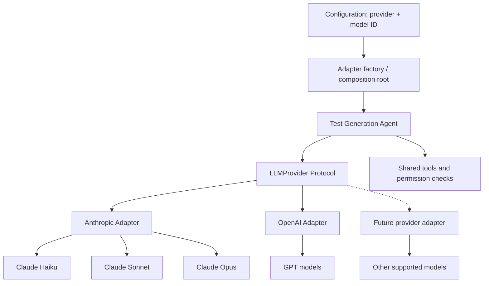

# Test Generation Agent

Status: Initial local Python/Claude tool-calling proof of concept reported working; remaining workflow and provider adapters are proposed.

A developer-facing agent that generates xUnit tests for StoryBoardGenerator. Related issues: [#17](https://github.com/mcyuune/StoryBoardGenerator/issues/17) and #4 (baseline tests).

## Workflow

## Proposed provider-independent architecture

Related: [#18](https://github.com/mcyuune/StoryBoardGenerator/issues/18). This is a future design, not an implemented capability.

- The agent depends on a shared Python protocol (similar to a C# interface), not a provider SDK.
- Shared contracts represent messages, tool definitions, tool calls, tool results and model responses.
- Each adapter translates requests and normalizes responses, preserving tool-call correlation IDs and required provider-specific conversation state.
- Model selection is configuration within a provider; changing providers selects a different adapter at the composition root.
- Tool execution, authorization and per-file context remain in the agent layer.
- Model families in the diagram are illustrative; exact supported model IDs and capabilities are configuration-dependent.

Implement this abstraction after the initial Claude-based MVP, validating it with a second provider.

## Proposed tools

- `ListFiles`: inspect repository structure.
- `ReadFile`: read relevant source and existing tests.
- `WriteTestFile`: write tests within approved paths.
- `CreateTestProject`: scaffold an xUnit project and references if missing.
- `RunTests`: execute tests and return results.

## Delivery plan

1. Build a local Python agent using Claude tool calling, starting with an existing test project and one source class.
2. Add bounded repair attempts using build and test feedback.
3. Support missing test-project setup.
4. Integrate with GitHub Actions and reviewable pull requests.

## Guardrails

Restrict writes and command execution, protect credentials, avoid real image API calls in unit tests, and require human review before merging. Treat repository content as untrusted input.

The diagram describes the intended workflow, not current functionality. Project scaffolding and automated repair are later capabilities.
