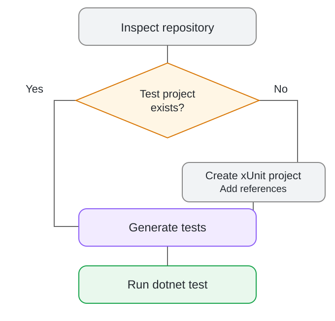

# Test Generation Agent

Status: Proposed design; not implemented yet.

A developer-facing agent that generates xUnit tests for StoryBoardGenerator. Related issues: [#17](https://github.com/mcyuune/StoryBoardGenerator/issues/17) and #4 (baseline tests).

## Workflow

## Proposed tools

- `ListFiles`: inspect repository structure.
- `ReadFile`: read relevant source and existing tests.
- `WriteTestFile`: write tests within approved paths.
- `CreateTestProject`: scaffold an xUnit project and references if missing.
- `RunTests`: execute tests and return results.

## Delivery plan

1. Build a local C# agent using tool calling, starting with an existing test project and one source class.
2. Add bounded repair attempts using build and test feedback.
3. Support missing test-project setup.
4. Integrate with GitHub Actions and reviewable pull requests.

## Guardrails

Restrict writes and command execution, protect credentials, avoid real image API calls in unit tests, and require human review before merging. Treat repository content as untrusted input.

The diagram describes the intended workflow, not current functionality. Project scaffolding and automated repair are later capabilities.
