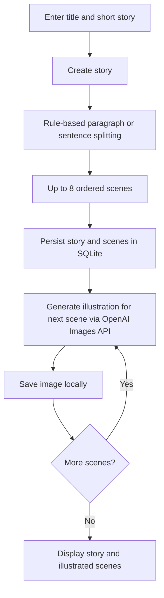

# V0 — Story to Storyboard
Status: Draft — current prototype and proposed hardening

## Product goal
Turn a short written story into sequential illustrated scenes, as an intermediate creative artifact between prose and a professional animation storyboard.

## Current functionality
- Enter a title and story text.
- Split text using rules (paragraphs or sentences, capped at eight scenes).
- Generate one illustration per scene through OpenAI Images API.
- Store stories and scenes in SQLite and images on the local filesystem.
- View the resulting story and illustrations.

## End-to-end workflow diagram

Current prototype happy path; partial failure handling remains an open question.

## Technical baseline
ASP.NET Core Razor Pages, C#, EF Core, SQLite, dependency injection, typed HttpClient and local image storage. Image generation currently runs sequentially within the create workflow and receives scene captions.

## Proposed completion criteria
- Clear README and safe public repository (after secret/history review).
- Resolve dependency security warnings.
- Automated tests for splitting and story creation with a fake image generator.
- Document configuration and failure behavior.
- Demonstrate a complete short-story workflow.

## Out of scope
Book ingestion, character extraction, character sheets, distributed processing and production cloud deployment.

## Learning goals
DI and service lifetimes, async/await, HTTP, Options Pattern, EF Core and testing.

## Open questions
How should partial generation failures be represented? Which prototype improvements should be completed before V1?
