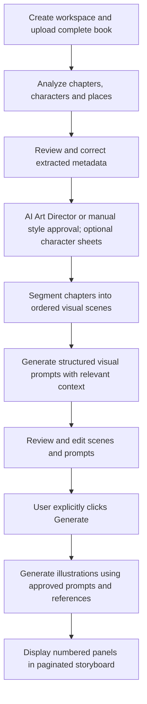
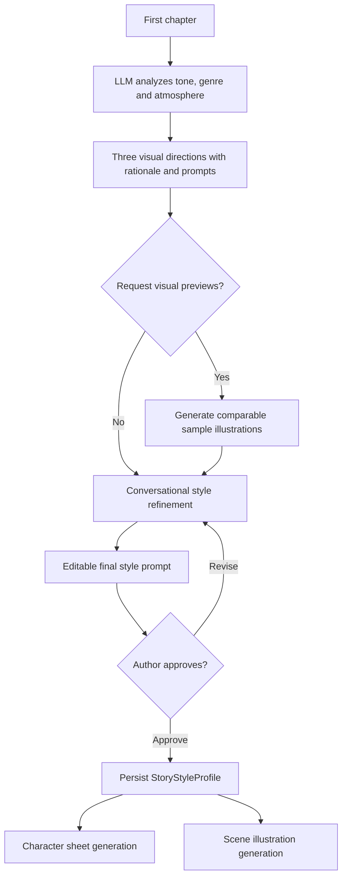

# V1 — Intelligent Storyboard Studio
Status: Draft — proposed product, not implemented

## Product goal
Understand a complete book before generating a visually coherent sketchbook-style storyboard.

## User workflow
1. Create a story workspace and upload a complete book.
2. Analyze the text to identify chapters, characters and relevant places.
3. Review and correct extracted information; refine and approve an illustration style in the AI Art Director (or manually), then optionally create and approve character sheets.
4. Once analysis is ready, explicitly click Generate.
5. Generate ordered scene illustrations using story context, approved character references and style.
6. Browse numbered panels with short captions in a paginated storyboard.

## End-to-end workflow diagram

Proposed user workflow. Analysis and prompt review precede explicit illustration generation; progress and failures should remain visible.

## Requirements
- Preserve original text and chapter/scene order.
- Persist extracted entities and allow corrections.
- Separate analysis from illustration generation; no automatic full storyboard generation on upload.
- Show analysis and generation progress and failures.
- Use consistent visual references; perfect character identity is not guaranteed.
- Compare flat grid and open sketchbook layouts (initial design target: eight panels per desktop spread).

## AI Art Director — Conversational Style Studio

Related issue: [#24](https://github.com/mcyuune/StoryBoardGenerator/issues/24).

### Product vision
Help authors discover a visual identity grounded in their book rather than requiring them to choose an animation or illustration preset upfront. The AI acts as a collaborative art director, not the final decision maker.

### User experience
1. Read the first chapter and infer genre, tone, atmosphere and visual cues.
2. Explain the interpretation and recommend three distinct visual directions, each with a rationale and candidate prompt.
3. Optionally generate previews of the same scene in different styles so the author can compare actual visual treatments. Preview generation is explicit and cost-aware.
4. Let the author discuss preferences in natural language, combine directions, request changes and edit the proposed prompt.
5. Display the final reusable style prompt and require explicit approval.
6. Persist the approved style and reuse it for character sheets and scene illustrations.

Manual style entry and presets remain alternative paths. A first chapter may not represent the whole book; later recommendations may incorporate the book summary and analysis.

### Illustrative screen and conversation
**Story Workspace / Illustration Style — Find your story's visual identity**

**AI:** I read the first chapter. The story combines magic, mystery and delicate emotions. I suggest three visual directions:

| Direction | Visual character |
| --- | --- |
| Soft Watercolor | Gentle, magical and dreamy |
| Pencil Storybook | Intimate, detailed hand-drawn sketches |
| Cinematic Fantasy | Dramatic, cinematic painted illustrations |

**Author:** I like the first direction, but I want less childish colors and more of a pencil-sketch feeling.

**AI:** Let's combine delicate pencil lines, watercolor washes, natural colors and a subtle sense of mystery.

**Your illustration style prompt (editable):**

> Hand-drawn graphite pencil illustrations with delicate watercolor washes, muted natural colors, expressive characters, subtle magical atmosphere, textured sketchbook paper and consistent visual language.

**Action:** Approve illustration style.

This is an illustrative conversation and screen concept, not an implemented UI or a fixed recommendation for every book.

### Workflow

### Proposed data and technical design
Persist a StoryStyleProfile with the approved prompt, illustration technique, color palette, visual mood, realism level, line and texture characteristics, and unwanted elements. Consider versioning approved profiles and recording which version generated each image. Keep conversational state separate from the approved profile; future image requests need the relevant approved style, not the full conversation. Combine it with scene-specific prompts and character references. Preserve the C# backend; an LLM conversation with structured outputs is sufficient for the initial implementation, without requiring an autonomous agent.

### Acceptance criteria
- Recommendations are grounded in the chapter and explain their reasoning.
- The author can refine the style conversationally and edit the final prompt.
- Optional previews allow meaningful comparison without triggering full storyboard generation.
- Approved style persists and is reused in subsequent character and scene generations.
- Style revisions do not silently alter existing images; consistent visual identity is a goal, not a guarantee.

### Learning goals and open decisions
Context engineering, conversational AI, structured outputs, human-in-the-loop approval, prompt engineering and conversation state. Decide preview count, cost limits, conversation persistence, profile schema/versioning and how later chapter context influences style.

## AI Scene Segmentation & Visual Prompt Generation

### Product goal
Translate literary text into an ordered visual narrative rather than sending raw paragraphs directly to the image model.

### Proposed workflow
1. Start with chapter text and preserve links to the original source passages.
2. Segment the text into ordered visual scenes.
3. Generate a structured visual prompt for each scene, including caption, action, setting, characters, emotion and optional camera framing.
4. Incorporate approved character references, appearance overrides and illustration style when available.
5. Allow the user to review and edit scenes and prompts before explicitly starting image generation.
6. Send approved prompts to the image generation model and display the resulting ordered storyboard.

### Incremental delivery
- Phase 1: Retain the existing rule-based paragraph/sentence splitter and use an LLM to transform each segment into a visual prompt.
- Phase 2: Introduce LLM-based scene segmentation using chapter context. The model may combine adjacent paragraphs describing one visual moment or split a paragraph containing several significant moments.
- Phase 3: Enrich prompts with relevant character, place and style context.

Retain RuleSplitGenerator as a baseline and candidate Simple Mode. AI Director Mode is a proposed alternative, not a finalized UI requirement.

### Technical considerations
Separate scene segmentation, visual prompt generation and image generation as logical responsibilities. The first two may use the same LLM and may be combined into one API request if evaluation supports it. Use structured outputs and validate scene ordering and source references. Keep captions distinct from image prompts. Preserve the C# backend and assess whether ISceneSplitter needs an asynchronous or richer contract. An autonomous agent is not required for this workflow.

### Acceptance criteria and evaluation
- The initial enhancement generates editable visual prompts from rule-based segments.
- AI segmentation can merge or split source paragraphs while preserving narrative order and traceability.
- Prompts remain faithful to the source and do not silently introduce unsupported story facts.
- Users can review and correct generated scenes and prompts before image generation.
- Compare rule-based and AI-based segmentation on representative stories for narrative coverage, visual coherence, faithfulness, latency and cost. Do not assume AI segmentation is always superior.

### Open decisions
Scene count and granularity controls, model selection, structured output schema, chapter context limits, whether to combine segmentation and prompt generation into one request, and whether to expose both modes to users.

## Proposed technical design
Keep the C# ASP.NET Core backend; incrementally introduce React and TypeScript with HTTP APIs. Use structured AI outputs for extraction and reference-aware image generation. Persist book, chapter, character, place, scene and generation metadata. Docker is a proposed deployment and learning step.

## Acceptance criteria
A complete supported book can be uploaded, analyzed, reviewed and explicitly generated into an ordered storyboard. Failures are visible and the user can retry without losing approved metadata.

## Out of scope
Distributed book ingestion, animation production and guaranteed character consistency.

## Learning goals
REST, structured AI outputs, prompt design, LLM evaluation, persistence, testing, background processing and Docker.

## Open decisions
Supported book formats and size limits, analysis strategy for long books, reference image API, storage, generation granularity and layout.
