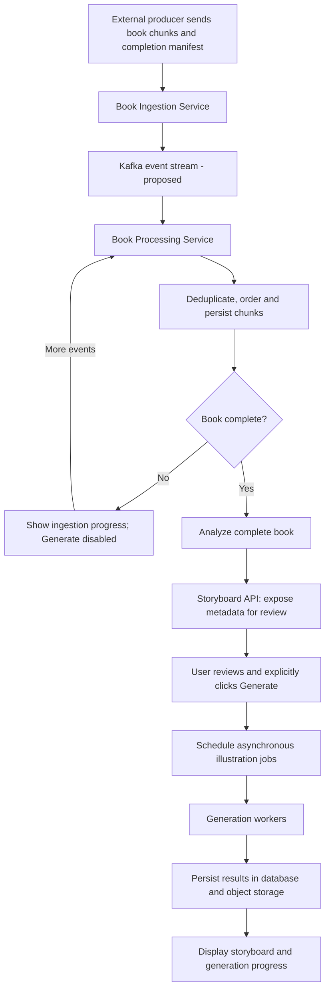

# V2 — Event-Driven Storyboard Platform
Status: Draft — proposed architecture and learning roadmap

## Product goal
Ingest a complete existing book incrementally through messages, assemble and analyze it reliably, and let the user explicitly generate its storyboard only after the entire book is ready.

## User workflow
An external producer submits paragraphs or chapters belonging to a book. The platform tracks ingestion progress, assembles the text in order, verifies completeness, analyzes the book and exposes it for review. Generate remains unavailable until ingestion and required analysis are complete. The user then starts illustration generation and tracks progress.

## End-to-end workflow diagram

Proposed end-to-end workflow. Missing chunks block readiness; failures must be visible and recoverable. Kafka and job scheduling topology are not finalized.

## Proposed architecture
- Book Ingestion Service: validate submissions and publish ingestion events.
- Kafka: durable event stream, with book ID as a proposed partition key.
- Book Processing Service: consume events, deduplicate and assemble book content; coordinate analysis.
- Storyboard API: expose book status, metadata and explicit generation commands.
- Generation workers: process illustration jobs asynchronously and persist results.
- Durable database and object storage: book state, metadata and images.

Kafka and a separate job queue are candidates, not a requirement to deploy both. Compare Kafka consumer groups with task queue semantics before choosing. Containerize services, deploy to a selected cloud, and evaluate Kubernetes after establishing a working deployment.

## Proposed event contract
Book ID, event ID, chunk index, text and schema version. Define a completion manifest or explicit end-of-book event with expected chunk count; do not infer completeness from inactivity. Handle duplicates, missing chunks, out-of-order arrivals and conflicting content. Persist progress and validate completeness before enabling generation.

## Reliability requirements
Idempotent consumers, bounded retries, failure handling, durable state, observability and recovery after restarts. Evaluate transactional outbox and offset/commit strategy. Prevent duplicate generation jobs; external API calls may still have ambiguous outcomes and require reconciliation rather than promises of exactly-once billing.

## Acceptance criteria
A book submitted in separate messages, including duplicate and out-of-order chunks, is assembled correctly. Missing chunks prevent readiness. After completion and analysis, the user can trigger generation; worker failures are visible and recoverable.

## Learning goals
Microservices, Kafka, message queues, partitioning, consumer groups, delivery semantics, idempotency, eventual consistency, Docker, cloud, observability and Kubernetes fundamentals.

## Open decisions
Producer interface, completion protocol, service boundaries, Kafka vs separate task queue, cloud provider, database ownership, security, cost limits and deployment topology. These are design questions, not finalized commitments.
